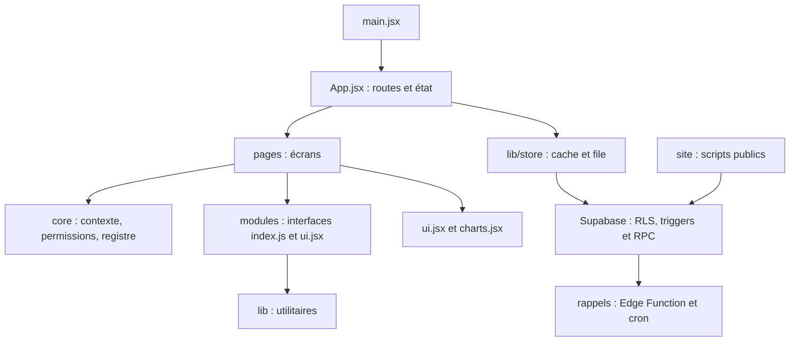

# Analyse complète du CRM Agence Elite — vendredi 9 octobre 2026

Commit analysé : **ff4abab** (`ff4ababf0f7f53daf9b40e32b80c2e1ba4fdf764`). Branche source : `claude/project-thread-j6wx9s`. Branche de livraison : `codex/analyse-2026-10-09`. Auteur : **Codex**.

Périmètre : CRM interne, site associé, Elite Store, SQL Supabase, tests, CI et documentation de ce dépôt. La plateforme commerciale externe et Le Kangourou ne sont pas audités. Leurs documents locaux sont consultés uniquement pour identifier les dépendances et les restes.

Méthode : lecture dans l'ordre demandé, inspection des sources et des imports, contrôles locaux, recherche de signatures de secrets dans le dépôt et l'historique accessible, requêtes publiques sans connexion. Aucune migration, correction, écriture Supabase ou modification de configuration. Seul ce rapport est ajouté au dépôt. Les installations et builds demandés produisent des fichiers ignorés par Git.

Limites : aucune connexion à la base ni au CRM ; aucune variable Supabase disponible. Les requêtes au domaine public et à l'API GitHub sont refusées par le réseau de cet environnement. Les politiques décrites sont celles du SQL versionné, pas une photographie de la production. Les lectures de gros fichiers combinent extraits ciblés, recherche et analyse statique ; elles ne constituent pas une preuve d'absence de tout défaut. Node local 24.19.0 ; référence projet et CI : Node 22. Aucun pourcentage de couverture instrumentée n'a été mesuré.

## Sommaire

1. [Résumé pour le dirigeant](#s1)
2. [Cartographie](#s2)
3. [Fonctionnel](#s3)
4. [Qualité du code](#s4)
5. [Données et Supabase](#s5)
6. [Sécurité](#s6)
7. [Performance](#s7)
8. [Hors ligne et synchronisation](#s8)
9. [UX, UI et accessibilité](#s9)
10. [Tests et CI](#s10)
11. [Déploiement et exploitation](#s11)
12. [Documentation](#s12)
13. [Comparaison avec septembre](#s13)
14. [Plan d'action priorisé](#s14)
15. [Annexes](#s15)

## 1. Résumé pour le dirigeant

Le CRM couvre bien l'activité commerciale et financière quotidienne ; les contrôles locaux passent.
**Maturité : 6/10**, jugement d'audit : fonctions solides, tests utiles, mais sécurité serveur, synchronisation et reprise encore incomplètes.
Les preuves principales sont les 77 tests unitaires réussis, les 27 parcours navigateur réussis et les défauts décrits ci-dessous.
Cinq risques majeurs : modification refusée puis oubliée (SYNC-01), gestion des membres sans contrôle 2FA dans les RPC (SEC-01), auteur modifiable permettant de contourner la suppression limitée (SEC-07), journée commune aux espaces (DATA-02), factures concurrentes et écritures financières non atomiques (DATA-01/FIN-01).
Cinq premières actions : conserver tous les refus de synchronisation ; contrôler la 2FA dans les RPC ; rendre l'auteur immuable ; séparer les journées par espace ; diagnostiquer puis appliquer l'unicité des numéros.
La boutique peut aussi déclarer une commande payée sur la parole du visiteur (SEC-04).
La sauvegarde proposée n'est pas une restauration complète de l'activité (OPS-01).
La production, ses migrations et ses en-têtes restent **Non vérifiés : accès distant indisponible**.
Ces corrections doivent faire l'objet de travaux séparés ; cet audit ne change pas le fonctionnement du site.

## 2. Cartographie

### Arborescence utile

| Dossier ou fichier | Rôle et preuve |
|---|---|
| `src/main.jsx`, `src/App.jsx` | Montage React, session, état partagé, routes et mutations ; `src/App.jsx:261`, `src/App.jsx:592`. |
| `src/core/` | Contexte, registre, permissions, événements, relations et composants communs ; `src/core/modules.js:5`. |
| `src/modules/commercial/` | Pipeline, objectifs, Instagram, appels, listes ; entrées `index.js` et `ui.jsx`. |
| `src/modules/facturation/` | Montants, statuts, numéros, PDF, impayés, messages et export Zoho ; `invoice.js:17`. |
| `src/modules/dashboard/` | Agrégations, cockpit et détail des chiffres ; `stats.js:1`. |
| `src/pages/` | 32 fichiers d'écrans et sous-écrans ; inventaire Git en annexe. |
| `src/lib/` | Stockage, synchronisation, cache, Excel, rappels, erreurs, sauvegarde et corbeille. |
| `src/ui.jsx`, `src/charts.jsx`, `src/index.css` | Composants, graphiques et styles partagés. |
| `public/` | PWA, logos, en-têtes et modèle Excel. |
| `site/` | Générateur statique et JavaScript public, distincts du React CRM ; `site/build.mjs:1`. |
| `supabase/` | Schéma historique, changements successifs, rappels, diagnostics SQL. |
| `tests/`, `e2e/`, `.github/` | Calculs, architecture, synchronisation, parcours et automatisation. |
| `plateforme/`, `archive/` | Documentation et brouillon hors runtime CRM ; aucun import applicatif relevé. |

Le registre contient **8 modules** : dashboard, commercial, facturation, charges, agenda, site, store, paramètres. L'interface regroupe **7 applications** : la boutique appartient à « Site web ». Ce n'est pas une contradiction : deux niveaux de regroupement (`src/core/modules.js:5`, `src/App.jsx:142-157`). Seuls trois modules ont un dossier métier dédié. Charges, agenda, site et store restent surtout dans les pages.

### Routes et dépendances

Les routes sont extraites du hash ; les paramètres de vue sont lus avec `URLSearchParams` (`src/App.jsx:264-267`, `src/App.jsx:592`). Les familles comprennent dashboard, journée, acquisition, clients, prospect avec identifiant, session, scripts, saisie, calendrier, factures, devis, facture avec identifiant, paiements, charges, dépenses, abonnements, site, site-demandes, site-pages, boutique, paramètres et apps (`src/App.jsx:615-641`). Les onglets sont des paramètres du hash, pas des routes serveur. Des liens historiques « prospects » servent de compatibilité.

`App` fournit le contexte aux pages ; les pages composent les fonctions commerciales et financières ; `store` concentre les accès aux trois tables de travail. Boutique et SiteWeb interrogent Supabase directement. Les graphiques sont partagés. Le PDF, le tableur et plusieurs pages sont chargés dynamiquement : liste des chunks en annexe.

Les assertions de `tests/architecture.test.js:1` vérifient que `core/` et `lib/` n'importent pas de module, et que les imports entre modules passent par `index.js` ou `ui.jsx`. Elles passent. Cela prouve les règles analysées par ce test, pas l'absence de dépendances indirectes via les pages. Le bus d'événements et le journal SQL ont des usages distincts : le registre décrit un contrat, pas un service serveur distribué (`src/core/events.js:1`, `supabase/evenements.sql:1`).

## 3. Fonctionnel

« Complet » signifie présent et utilisable dans le périmètre inspecté, pas sans défaut ni certifié en production. P/A/D/S désignent prospects, actions, documents et réglages. Chaque ligne cite le fichier de l'écran ; le routage est vérifié dans `src/App.jsx:615-641`. Les lectures locales utilisent les données déjà chargées dans le contexte.

| Écran ou composant | Ce qu'il fait ; données lues/écrites | État et preuve |
|---|---|---|
| Applications | Entrées des applications et liens ; lit registre/S | Complet, `src/pages/Applications.jsx:1`. |
| Bilan | Synthèse de la journée ; lit A et objectifs D/S | Complet, sous-écran ; `src/pages/Bilan.jsx:1`. |
| Boutique | Produits, commandes, clés ; écrit tables store, P/A associés | Partiel : paiement manuel/simulation et risques de concurrence ; `src/pages/Boutique.jsx:33`, `src/pages/Boutique.jsx:162`. |
| Calendrier | RDV, relances, échéances ; lit A/D/P | Complet, `src/pages/Calendrier.jsx:1`. |
| Charges | Dépenses et abonnements ; lit/écrit A/S | Complet pour suivi interne, `src/pages/Charges.jsx:1`. |
| Clients | Composants client réutilisés par le hub ; lit P/A/D | Actif, pas un doublon mort ; `src/pages/Clients.jsx:1`. |
| Cockpit | Indicateurs et filtres commerciaux/financiers ; lit P/A/D/S et compte les demandes | Complet mais très volumineux ; `src/pages/Cockpit.jsx:1`, `src/pages/Cockpit.jsx:645`. |
| DashPlus | Compléments du tableau de bord ; lit P/A/D | Actif dans Dashboard, `src/pages/DashPlus.jsx:1`. |
| Dashboard | Synthèse, cockpit, trésorerie et navigation de détail | Complet, `src/pages/Dashboard.jsx:1`. |
| Drill | Liste expliquant un chiffre ; lit P/A/D | Complet, `src/pages/Drill.jsx:1`. |
| Factures | Listes, devis, édition, PDF ; lit/écrit D/P/A | Partiel sur garanties comptables/concurrence ; `src/pages/Factures.jsx:219-271`. |
| Fiche | Fiche prospect/client et chronologie ; lit/écrit P/A | Complet, `src/pages/Fiche.jsx:1`. |
| FicheForm | Formulaire de qualification ; écrit `prospects.fiche` | Complet, JSON souple ; `src/pages/FicheForm.jsx:1`. |
| Finances | Paiements, dépenses et saisies ; lit/écrit A/D | Complet pour suivi ; garanties transactionnelles partielles ; `src/pages/Finances.jsx:177`. |
| Hub | Acquisition/clients, kanban, filtres, Instagram | Complet, `src/pages/Hub.jsx:1`. |
| Insta | Listes Instagram et suivi ; lit/écrit P/A | Actif dans hub/fiche, `src/pages/Insta.jsx:1`. |
| Journee | Travail du jour et objectifs ; lit P/A/D/S | Complet mono-espace, conflit structurel multi-espace ; `src/pages/Journee.jsx:1`. |
| Login | Connexion/session Supabase et mode local | Présent ; authentification réelle non testée ; `src/pages/Login.jsx:1`. |
| Membres | Invitations et rôles ; RPC membres | Partiel sur sécurité serveur MFA ; `src/pages/Membres.jsx:1`. |
| Modules | Activation des modules ; écrit S | Complet ; ce masquage ne constitue pas un contrôle RLS ; `src/pages/Modules.jsx:1`. |
| Objectifs | Objectifs/activité du jour ; écrit D type journée | Partiel multi-espace ; `src/pages/Objectifs.jsx:31`. |
| Parametres | Identité, devise, apparence, imports, sécurité, sauvegarde | Complet mais dense ; `src/pages/Parametres.jsx:1`. |
| Prospects | Anciens composants/liste et création réutilisés | Compatibilité active, pas page autonome principale ; `src/pages/Prospects.jsx:1`. |
| Raccourcis | Aide clavier/navigation | Complet desktop ; `src/pages/Raccourcis.jsx:1`. |
| Rapide | Saisie rapide d'activité | Complet, `src/pages/Rapide.jsx:1`. |
| Recherche | Recherche globale dans les données chargées | Complet à volume modéré ; `src/pages/Recherche.jsx:1`. |
| Saisie | Appel/contact/qualification et relance ; écrit P/A | Complet, `src/pages/Saisie.jsx:1`. |
| Scripts | Scripts commerciaux depuis les réglages | Complet, `src/pages/Scripts.jsx:1`. |
| Securite | Activation et challenge MFA | Présent ; parcours réel non vérifié ; `src/pages/Securite.jsx:1`. |
| Session | Session d'appels et objectifs | Complet ; alertes de pureté React ; `src/pages/Session.jsx:53`, `src/pages/Session.jsx:68`. |
| SiteWeb | Visites, demandes, conversion en prospect et pages | Partiel sur isolation de l'espace et volumes ; `src/pages/SiteWeb.jsx:47-49`. |
| Tresorerie | Projections et solde ; lit A/D/S | Actif dans Dashboard ; `src/pages/Tresorerie.jsx:1`. |

### Parcours de bout en bout

Le pipeline commercial est calculé depuis les activités et la fiche (`src/modules/commercial/pipeline.js:1`, `src/lib/logic.js:1`). Les canaux et étapes se personnalisent via les réglages. Le parcours prospect → activité/relance → devis → facture → paiement → dashboard existe. Les tests unitaires couvrent des calculs et les parcours locaux exercent plusieurs étapes (`tests/lib.test.js:1`, `e2e/parcours.spec.js:1`). Cela ne valide pas les écritures réelles Supabase.

| ID | Rupture possible et preuve | Impact | Correctif proposé |
|---|---|---|---|
| FIN-01 | Création du prospect, action commerciale, modification des paiements et document réalisées successivement ; `src/pages/Factures.jsx:219-271` | Une coupure/refus laisse une opération financière incomplète ; le tableau peut montrer une étape commerciale sans facture valide | Une RPC transactionnelle et une opération hors ligne groupée/idempotente. |
| FIN-02 | TVA arrondie à l'unité ; `src/modules/facturation/invoice.js:32-38` | En EUR, 100,10 à 20 % produit 120,10 au lieu de 120,12 ; reproduction locale par appel de la fonction | Calculer en unités monétaires mineures selon la devise. |
| FIN-03 | Devise globale et conversion des paramètres seulement ; `src/pages/Parametres.jsx:62-80`, `src/pages/Factures.jsx:196` | Les anciens montants peuvent être réaffichés avec une autre monnaie, sans conversion historique | Stocker la devise par document/écriture et contrôler les agrégations. |
| FIN-04 | Statut de commande payé puis ajout d'action avec erreur absorbée ; attribution des clés en écritures séparées ; `src/pages/Boutique.jsx:162-186` | Commande payée sans encaissement CRM, ou attribution concurrente d'une clé | Transaction serveur avec clé d'idempotence et verrouillage des clés disponibles. |

Le rapprochement d'un paiement repose notamment sur le numéro textuel de facture (`supabase/schema.sql:27`, `src/pages/Factures.jsx:255`), pas sur une clé étrangère vers le document. Une renumérotation concurrente peut désaligner les deux. Les statuts recalculés sont utiles mais exigent des actions cohérentes. Un devis/facture interne n'est pas une preuve de conformité fiscale de tous les pays visés : **Non vérifié : aucune expertise réglementaire locale ni facturation de production examinée**.

Aucun des 32 fichiers de pages n'est déclaré « mort » sans preuve. Les anciens noms Clients/Prospects et DashPlus/Tresorerie représentent surtout des composants réutilisés. Les documents `plateforme/` et `archive/` ne sont pas du runtime ; le connecteur Domaines a été retiré au commit `743c036`.

## 4. Qualité du code

### Taille et organisation

Comptage de lignes et octets des fichiers suivis, hors fichiers générés. Il ne s'agit pas d'une mesure de complexité cyclomatique.

| Fichier | Lignes | Octets | Conséquence |
|---|---:|---:|---|
| `src/pages/Cockpit.jsx` | 1 172 | 59 697 | Nombreux calculs et modes d'affichage à maintenir ensemble. |
| `src/pages/Parametres.jsx` | 1 001 | 50 102 | Paramètres, import/export, compte et apparence couplés. |
| `src/App.jsx` | 808 | 40 115 | Routes, mutations et shell centralisés. |
| `src/pages/Factures.jsx` | 685 | 31 865 | Edition et orchestration financière regroupées. |
| `src/pages/Hub.jsx` | 682 | 30 460 | Plusieurs vues métier dans un fichier. |
| `src/pages/Boutique.jsx` | 642 | 28 244 | Administration et opérations sensibles mélangées. |
| `src/pages/Dashboard.jsx` | 633 | 31 750 | Composition et calculs encore importants. |
| `src/lib/store.js` | 610 | 25 106 | Session, espaces, cache, file et écritures dans le même service. |
| `src/index.css` | 1 976 | 146 714 | Accumulation de règles et adaptations. |
| `site/assets/site.css` | 2 568 | 44 256 | Styles du site séparés, gros fichier. |
| `site/build.mjs` | 788 | 49 818 | Génération de nombreuses pages et sections. |

| ID | Constat et preuve | Gravité / effort | Correctif |
|---|---|---|---|
| QUAL-01 | Gros écrans ci-dessus, responsabilité large ; `src/pages/Cockpit.jsx:1`, `src/lib/store.js:1` | MOYEN / L | Extraire d'abord calculs et orchestration sensibles, puis sections UI. |
| QUAL-02 | Conversions numériques répétées ; `src/lib/logic.js:4`, `src/modules/facturation/invoice.js:5`, `src/lib/tresorerie.js:3`, `src/pages/Objectifs.jsx:10` | MOYEN / M | Une fonction monétaire commune, rejetant aussi les valeurs non finies. |
| QUAL-03 | Erreurs absorbées dans écritures/cache et notifications ; `src/lib/store.js:435`, `src/pages/Boutique.jsx:167`, `supabase/functions/rappels/index.ts:65` | ÉLEVÉ / M | Différencier échec, attente et succès ; garder une trace récupérable. |
| QUAL-04 | 49 avertissements, dont pureté et hooks ; commande oxlint en annexe | FAIBLE / M | Traiter d'abord hooks/pureté ; séparer les exports utilitaires progressivement. |

Les noms français sont généralement cohérents. Des conventions techniques anglaises restent normales (`workspace`, `settings`, événements). Une table `actions` portant appels, ventes, dépenses et paiements rend certaines validations difficiles : voir DATA-04. Le découpage déjà effectué en modules mérite d'être conservé. Pas de réécriture générale recommandée.

### Lint détaillé

`npx --no-install oxlint` : sortie 0, **49 avertissements, 0 erreur**.

| Règle | Nombre | Localisation / interprétation |
|---|---:|---|
| `react(only-export-components)` | 33 | Mélange composants/fonctions dans des fichiers ; concerne notamment le rechargement de développement. |
| `eslint(no-unused-vars)` | 8 | `site/assets/site.js:104,119,132,142` ; `src/lib/store.js:12,18,106,113`. |
| `react(set-state-in-effect)` | 4 | `src/App.jsx:376`, `src/pages/Boutique.jsx:42`, `src/pages/SiteWeb.jsx:56`, `src/pages/Membres.jsx:34`. |
| `react(purity)` | 2 | `src/pages/Session.jsx:53,68`. |
| `react(preserve-manual-memoization)` | 1 | `src/pages/Calendrier.jsx:82`. |
| `react-hooks(exhaustive-deps)` | 1 | `src/pages/Hub.jsx:168`. |

S : environ une journée ; M : quelques jours ; L : une semaine ou davantage, selon validation métier. Ce sont des estimations, pas des engagements.

## 5. Données et Supabase

### Modèle reconstitué

Le tableau décrit les colonnes versionnées, y compris les ajouts ultérieurs. `workspace_id` est ajouté à neuf tables par `supabase/espace_donnees.sql:25-34`. Les références à `auth.users` sont des liens internes ; aucune valeur d'identifiant n'est reproduite.

| Table | Colonnes et relations | Contraintes/index principaux ; preuve |
|---|---|---|
| prospects | id, user_id, name, fiche JSON, created_at, workspace_id | PK id ; auteur requis ; index auteur/espace ; `supabase/schema.sql:3-9`. |
| actions | id, user_id, prospect_id, date, time, canal, action, resultat, montant, duree, prochaine_action, date_relance, heure_rappel, objection, modele, note, facture, remise, notes, created_at ; mode, reference, categorie, fournisseur, recu ; workspace_id | FK prospect cascade ; date et action requises ; index prospect/date/auteur/espace ; `supabase/schema.sql:11-36`, `supabase/schema.sql:77-81`. |
| documents | id, user_id, type, numero, prospect_id, data JSON, created_at, workspace_id | FK prospect SET NULL ; index auteur/prospect/espace ; unicité additionnelle en attente ; `supabase/schema.sql:60-74`. |
| settings | user_id, data JSON, updated_at, workspace_id | PK auteur et index unique espace ; une seule ligne possible par propriétaire malgré plusieurs espaces éventuels ; `supabase/schema.sql:38-42`, `supabase/espace_permissions.sql:13-26`. |
| workspaces | id, owner_id, nom, site_public, created_at | PK ; FK propriétaire ; un seul site public global ; `supabase/espaces.sql:7-16`. |
| workspace_members | workspace_id, user_id, role, created_at | PK composée, FKs, rôle contraint ; index utilisateur ; `supabase/espaces.sql:18-25`. |
| site_visites | id, user_id, jour, page, source, appareil, created_at, workspace_id | Index auteur/jour ; `supabase/site.sql:4-13`. |
| site_demandes | id, user_id, nom, entreprise, tel, email, solution, message, canal, page, prospect_id, traitee, created_at, workspace_id | Indicateur traitee et lien prospect ; index date ; `supabase/site.sql:15-30`. |
| store_produits | id, user_id, slug, categorie, nom, editeur, resume, description, duree, appareils, inclus JSON, prix, prix_barre, periode, image, livraison, a_confirmer, actif, vedette, ordre, created_at, workspace_id | Slug unique global ; prix ≥ 0 ; livraison contrainte ; `supabase/store.sql:5-27`. |
| store_commandes | id, user_id, numero, client/lignes JSON, total, statut, mode_paiement, demo, prospect_id, notes, created_at, payee_le, livree_le, workspace_id | Numéro unique global ; statut contraint ; FK prospect ; `supabase/store.sql:29-44`. |
| store_cles | id, user_id, produit_id, cle, commande_id, attribuee_le, created_at, workspace_id | FKs produit/commande ; index clés disponibles et commande ; `supabase/store.sql:46-60`. |
| push_subscriptions | id, user_id, endpoint, keys JSON, appareil, created_at | Endpoint unique ; index auteur ; `supabase/rappels.sql:4-15`. |
| rappels | id, user_id, quand, titre, corps, url, cle, envoye, created_at | Unique auteur/clé ; index partiel non envoyés ; `supabase/rappels.sql:17-32`. |
| push_config | id, vapid_public, vapid_private, cron_secret | Singleton ; secret généré, accès service uniquement ; `supabase/rappels.sql:35-43`. |
| client_errors | id, user_id, message, stack, page, agent, version, created_at | Index auteur/date ; `supabase/client_errors.sql:2-19`. |
| audit_log | id, at, acteur, role, operation, table_name, entite_id, proprietaire, champs, appareil, ip, workspace_id | Journal serveur ; index propriétaire/date et espace/date ; `supabase/audit.sql:6-24`, `supabase/espace_permissions.sql:33-65`. |
| events | id, workspace_id, type, date, at, acteur, module, entite, entite_id, meta JSON, correlation_id, source, annule, version, modifie_le | Source unique, index espace/date et corrélation ; `supabase/evenements.sql:6-27`, `supabase/evenements_modifications.sql:9-10`. |
| private.inscriptions_autorisees | email | PK, valeur en minuscules ; `supabase/espaces.sql:79`. |
| private.invitations | workspace_id, email, role, invite_par, created_at, acceptee_le | Invitation par espace/adresse, gestion par RPC ; `supabase/acces_membres.sql:60-69`. |

Le bucket privé **recus** accepte JPEG, PNG, WebP, HEIC et PDF, maximum 5 MiB. Les chemins sont cloisonnés par auteur, pas par espace (`supabase/schema.sql:84-98`). Un collègue autorisé sur la dépense ne reçoit donc pas automatiquement le droit de lire son reçu. **DATA-06, MOYEN** : partage métier et partage du fichier divergent ; proposer une règle Storage par espace avec contrôle de la dépense associée. Aucune lecture réelle de reçu partagé vérifiée.

### Fonctions, triggers et exploitation SQL

| Famille | Fonction / rôle / preuve |
|---|---|
| Accès | `mfa_ok`, `mes_espaces`, `espace_de`, `espaces_ecriture`, `espaces_gestion` ; calculent les droits ; `bootstrap_prerequis.sql:8`, `espaces.sql:28`, `acces_membres.sql:9`. |
| Membres | `verifier_gestion`, `inviter_membre`, `changer_role`, `retirer_membre`, `annuler_invitation`, `membres_espace` ; RPC SECURITY DEFINER ; `acces_membres.sql:71-140`. |
| Inscription | `crm_single_owner`, `crm_nouvel_espace` ; garde prévue et création espace/adhésions ; `espaces.sql:83-107`, `acces_membres.sql:143`. |
| Réglages | `enregistrer_reglages` vérifie explicitement MFA et rôle gestion ; `espace_permissions.sql:15-29`. |
| Site | `site_proprietaire`, `site_visite`, `site_contact` ; propriétaire dérivé de l'espace public, insertions publiques encadrées ; `espaces.sql:57`, `site.sql:46,66`. |
| Store | `store_passer_commande` relit les prix et crée commande/prospect/action ; `store.sql:82-152`. |
| Audit | `journaliser` + triggers insert/update/delete ; champs modifiés, acteur/appareil/IP ; `audit.sql:26-53`, `espace_permissions.sql:38-65`. |
| Métier | `type_action`, `module_du_type`, `date_sure`, `evenement_action`, `evenement_document` ; triggers sur actions/documents, gestion des modifications/version ; `evenements.sql:29-109`, `evenements_modifications.sql:12-79`. |
| Rattachement | `rattacher_espace` avant insertion/update de workspace_id ; rattache et empêche déplacement ; `espace_donnees.sql:34`, `espace_permissions.sql:99-110`. |

Realtime publie actions, prospects, documents et site_demandes (`supabase/realtime.sql:2`). Le frontend recharge les données à réception plutôt que d'appliquer uniquement un delta (`src/lib/store.js:470-478`). Settings et boutique ne sont pas dans cette publication. Le cron appelle `rappels` toutes les cinq minutes avec un secret généré en base (`supabase/rappels.sql:49-57`). **Non vérifié : extensions installées, publication effective, jobs actifs et Edge Function déployée**.

### Ordre de rejeu et intégrité

Le manifeste `supabase/migrations/legacy-order.txt:1` donne 15 scripts historiques. Le script `scripts/supabase-bootstrap.sh:14-22` les exécute puis applique les migrations SQL versionnées ; les diagnostics/migration Pareto sont aussi documentés (`supabase/README.md:1`). C'est un progrès important. Ce n'est pas encore un rejeu démontré sur une base vierge : **Non vérifié : aucune base jetable disponible et interdiction de migration**. Il faut les services Auth/Storage Supabase, les extensions nécessaires, l'autorisation d'inscription et une configuration adaptée du cron. Le cron contient l'URL du projet existant ; un clone ne doit pas appeler ce projet par défaut.

| ID | Constat et preuve | Gravité / impact | Correctif |
|---|---|---|---|
| DATA-01 | Index unique `(workspace_id,type,lower(btrim(numero)))` préparé ; documentation le dit non appliqué ; `supabase/migrations/20260930180000_pareto_v1_documents_uniques.sql:10-12`, `docs/KNOWN_ISSUES.md:5` | ÉLEVÉ : deux factures peuvent avoir le même numéro si l'index manque | Diagnostic et sauvegarde, résoudre doublons, appliquer séparément ; allocation serveur du numéro. |
| DATA-02 | L'identifiant de journée dépend de la date seule ; `src/modules/commercial/journee.js:22`, `src/pages/Objectifs.jsx:31`, PK globale `supabase/schema.sql:61` | ÉLEVÉ : même jour de deux espaces cible le même document ; refus RLS ou collision selon droits | Identifiant distinct par espace/jour, contrainte serveur, test deux espaces. |
| DATA-03 | Résolution asynchrone de l'espace dans fetchAll, réglages demandés parallèlement ; `src/lib/store.js:235-253` | MOYEN : réglages potentiellement sans filtre à la première lecture multi-espace ; risque statique, non reproduit | Résoudre l'espace avant toutes les requêtes, dont settings. |
| DATA-04 | fiche/data/settings libres, action/type textuels ; validations métier surtout navigateur ; `supabase/schema.sql:7,17,63,67`, `src/lib/store.js:371-380` | ÉLEVÉ : API directe peut produire valeurs/formes incohérentes ; FK prospect non composée avec l'espace | Contraintes et validations serveur ; FK composée ou trigger vérifiant le même espace. |
| DATA-05 | Boutique/SiteWeb et compteur Cockpit sans filtre d'espace actif ; `src/pages/Boutique.jsx:33-36`, `src/pages/SiteWeb.jsx:47-49`, `src/pages/Cockpit.jsx:645-648` | MOYEN : mélange des espaces auxquels le compte a accès ; pas une preuve d'accès à un espace interdit | Centraliser les requêtes filtrées par espace et paginer. |

Indexes encore absents du schéma versionné pour `site_demandes.prospect_id` et `store_cles.user_id`, également signalés dans `docs/KNOWN_ISSUES.md:10` : **PERF-05, FAIBLE**, à ajouter après mesure des requêtes et du volume. Les index auteur/espace existants ne remplacent pas forcément ces accès.

Le calcul `nextNumero` cherche le maximum dans les documents connus (`src/modules/facturation/invoice.js:17-29`). `numeroLibre` fait une vérification à distance (`src/lib/store.js:543`), mais deux appareils peuvent la réussir ensemble. Une vérification avant écriture ne remplace pas une contrainte. L'index normalise les espaces et la casse ; la pré-vérification ne doit pas avoir une autre définition de l'égalité. **Non vérifié : doublons réels, application de l'index et migrations de production au 9 octobre**.

Étape commerciale et statut financier sont dérivés d'actions/documents. Supprimer ou modifier une action peut faire reculer une étape ou modifier un solde. Les events/audit rendent le changement plus traçable, mais ne remplacent pas les validations ou une transaction de facturation (`supabase/evenements_modifications.sql:12-79`).

## 6. Sécurité

### RLS table par table

« Oui » signifie RLS activée dans les scripts. Les policies permissives se combinent par OU ; les policies restrictives MFA/espace ajoutent des conditions. Le tableau décrit le résultat attendu après l'ordre complet, notamment la suppression des anciennes règles own dans `supabase/espace_permissions.sql:68-96`.

| Table | RLS | Règle attendue / réserve | Preuve |
|---|---|---|---|
| prospects | Oui | Membres lisent ; membre+ crée/modifie ; gestion supprime tout, membre supprime son auteur ; MFA/espace | `schema.sql:45`, `acces_membres.sql:35-55`, `espace_permissions.sql:68-77`. |
| actions | Oui | Même règle ; auteur modifiable : SEC-07 | `schema.sql:46`, mêmes scripts. |
| documents | Oui | Même règle ; index numéro non garanti en production | `schema.sql:71`, mêmes scripts. |
| settings | Oui | Membres lisent ; écriture par RPC gestion + MFA ; PK auteur limite plusieurs espaces d'un propriétaire | `acces_membres.sql:49`, `espace_permissions.sql:13-29`. |
| workspaces | Oui | Membres lisent ; propriétaire modifie ; MFA restrictive | `espaces.sql:34-43`. |
| workspace_members | Oui | Adhésions lisibles aux membres ; gestion via RPC ; MFA des policies contournable dans RPC sans contrôle propre | `espaces.sql:35-45`, `acces_membres.sql:71-140`. |
| site_visites | Oui | Gestion espace écrit ; membres lisent selon politiques ajoutées ; RPC publique écrit en definer | `site.sql:32-43`, `acces_membres.sql:49`, `espace_permissions.sql:87-92`. |
| site_demandes | Oui | Même principe ; formulaires publics passent par RPC | `site.sql:33-43`, mêmes scripts. |
| store_produits | Oui | Gestion espace écrit ; catalogue actif du propriétaire public lisible anonymement | `store.sql:62`, `espace_permissions.sql:87-96`. |
| store_commandes | Oui | Gestion espace écrit ; membres lisent ; RPC publique crée | `store.sql:63`, `acces_membres.sql:49`, `espace_permissions.sql:87-92`. |
| store_cles | Oui | Gestion écrit, membres lisent selon policy ; clés de licence sensibles aux membres lecteurs | `store.sql:64`, `acces_membres.sql:46-50`, `espace_permissions.sql:87-92`. |
| push_subscriptions | Oui | Auteur seulement + MFA | `rappels.sql:12-14`, `double_auth.sql:24`. |
| rappels | Oui | Auteur seulement + MFA ; pas de scope espace | `rappels.sql:30-32`, `double_auth.sql:22`. |
| push_config | Oui | Aucun droit anon/authenticated ; service privilégié | `rappels.sql:41-43`. |
| client_errors | Oui | Auteur insert/select/delete ; MFA | `client_errors.sql:12-18`, `double_auth.sql:32`. |
| audit_log | Oui | Gestion espace lit ; écrit seulement triggers ; MFA | `audit.sql:20-24`, `espace_permissions.sql:65`. |
| events | Oui | Membres espace lisent + MFA ; pas de policy écriture utilisateur | `evenements.sql:23-27`. |
| private.inscriptions_autorisees | Non déclarée | Schéma privé ; accès indirect par fonction ; ne pas exposer le schéma/grants | `espaces.sql:79-93`. |
| private.invitations | Non déclarée | Schéma privé, manipulation via fonctions definer ; vérifier les grants effectifs | `acces_membres.sql:60-140`. |
| storage.objects / recus | Policies | Auteur via premier segment du chemin ; pas partage d'espace ni MFA explicite dans ces policies | `schema.sql:88-98`. |

**Non vérifié : grants réels sur schéma public/private, privileges CREATE, configuration des schémas exposés et politiques déployées.** L'absence de RLS déclarée sur une table privée n'implique pas qu'elle soit publiquement accessible. À l'inverse, le frontend ne suffit jamais à empêcher un appel API direct.

### Problèmes prioritaires

| ID | Gravité | Constat et preuve | Impact / correction |
|---|---|---|---|
| SEC-01 | ÉLEVÉ | `private.verifier_gestion` contrôle le rôle sans `mfa_ok` ; RPC de gestion SECURITY DEFINER et lecture membres également sans contrôle MFA ; `supabase/acces_membres.sql:71-78,82-140` | Une session de gestion au niveau aal1 peut appeler ces fonctions malgré les policies MFA. Vérifier explicitement MFA dans les RPC/helpers et tester chaque fonction. Exploitation réelle non essayée. |
| SEC-02 | ÉLEVÉ | `crm_single_owner` est définie mais aucun trigger de garde d'inscription ne l'attache dans le rejeu versionné ; seul trigger de création espace ; `supabase/espaces.sql:83-107`, recherche `git grep 'crm_single_owner' -- supabase` | Une nouvelle base ne reproduit pas la restriction d'inscription annoncée. Installer explicitement la garde et tester un compte non autorisé. Un ancien trigger peut exister en production : non vérifié. |
| SEC-03 | MOYEN | Déconnexion nettoie cache/file/reçus/conflits, pas la corbeille pleine de fiches ; `src/lib/store.js:314-316`, `src/lib/corbeille.js:2-31`, `src/pages/Parametres.jsx:970-972` | Informations conservées sur un appareil partagé. Cloisonner tout stockage par compte/espace et purger à la déconnexion. |
| SEC-04 | ÉLEVÉ | RPC anonyme accepte un mode carte simulation du client et marque payée sans condition serveur imposant demo ; `supabase/store.sql:101,142-152` ; garde frontend `site/assets/store.js:405-422` | Fausse commande payée sans encaissement. Le serveur doit imposer attente hors sandbox ; paiement validé seulement par preuve serveur. Aucun appel d'écriture réalisé. |
| SEC-05 | MOYEN | `_headers` ne définit que le cache du worker ; `public/_headers:1-2` | Protection HTTP non documentée dans le dépôt. Définir CSP adaptée, anti-framing, Referrer/Permissions et HSTS approprié ; mesurer d'abord les en-têtes Cloudflare. Production non vérifiée. |
| SEC-06 | FAIBLE | Pas de `permissions` explicites ; actions référencées par tags v4 ; `.github/workflows/ci.yml:1-42` | Droits CI dépendants des réglages GitHub et versions amont mobiles. Déclarer droits minimaux et épingler les actions par hash validé. |
| SEC-07 | ÉLEVÉ | UPDATE exige l'espace mais pas l'immutabilité de user_id ; DELETE propre repose sur user_id ; `supabase/acces_membres.sql:42`, `supabase/espace_permissions.sql:77,99-110` | Un membre autorisé à modifier peut se déclarer auteur puis supprimer une ligne d'autrui. Rendre l'auteur immuable côté serveur ; test API/RLS spécifique. Constat statique, aucune exploitation distante. |

Aucun problème n'est classé CRITIQUE sans preuve d'une compromission immédiate ou d'un accès privilégié public. Les risques élevés ci-dessus suffisent à justifier une correction rapide.

### SECURITY DEFINER, permissions et 2FA

La majorité des nouvelles fonctions privées utilisent `search_path = ''` et des tables qualifiées. Site et Store gardent `search_path = public` (`supabase/site.sql:50,70`, `supabase/store.sql:86`). Durcir ce chemin reste souhaitable : le risque d'usurpation d'objet dépend des privileges CREATE réellement accordés, non vérifiés. Les fonctions RPC doivent vérifier elles-mêmes rôle, espace et MFA, car l'exécution definer peut contourner la RLS.

Le propriétaire public est désormais obtenu par `private.site_proprietaire` à partir de l'espace public (`supabase/espaces.sql:57-76`). Un ancien identifiant apparaît encore comme chaîne de remplacement dans la migration, pas comme décision de propriétaire en runtime (`supabase/espaces.sql:70`). Le problème de septembre est largement corrigé dans les définitions finales, sous réserve d'application réelle du SQL.

`src/core/permissions.js:1` gère les rôles d'interface. Le SQL limite aussi les écritures ; ce n'est donc plus uniquement cosmétique. Mais désactiver un module n'interdit pas en soi ses tables à un utilisateur authentifié. Les lecteurs peuvent lire des données d'espace, y compris les clés de licence selon les policies de lecture : valider ce choix métier et limiter si inutile. Les règles Storage n'ajoutent pas la restriction MFA des tables métier.

### Stockage local, injection et secrets

Cache, file, conflits et corbeille contiennent des données commerciales lisibles dans le navigateur (`src/lib/store.js:1`, `src/lib/conflits.js:1`, `src/lib/corbeille.js:2`). Ce n'est pas un coffre chiffré. Une session Supabase est également persistée par le SDK. Les sauvegardes téléchargées contiennent les données métier en clair (`src/lib/sauvegarde.js:14-19`). Prévoir verrouillage de l'appareil, séparation des comptes et purge fiable ; ne pas retirer le hors ligne sans solution métier.

Aucun `dangerouslySetInnerHTML` trouvé dans les sources React par recherche. Les scripts publics construisent du HTML ; leurs fonctions d'échappement ont été examinées (`site/assets/store.js:23-26`, `site/assets/site.js:1`). Cela ne démontre pas l'absence de toute injection. Le logo importé est converti via canvas en image (`src/pages/Parametres.jsx:139-154`). Le PDF utilise des images/réglages (`src/modules/facturation/invoicePdf.js:25-49`) ; une liste de sources autorisées serait un durcissement, pas une faille XSS démontrée. Aucun payload malveillant n'a été envoyé au site.

Recherche de signatures de secrets sur l'historique accessible : **98 commits, 804 blobs distincts**, zéro correspondance de clé privée, jeton GitHub, clé AWS ou clé secrète de type recherché ; seconde recherche de valeurs littérales de credential sans résultat retenu. C'est une recherche heuristique, pas une certification. Des adresses d'inscription et identifiants historiques sont présents, valeurs volontairement omises.

| Emplacement | Type constaté, sans valeur | Traitement |
|---|---|---|
| `supabase/espaces.sql:49,81` | Adresse autorisée de connexion | Donnée personnelle/configuration ; externaliser si nécessaire. |
| `supabase/espaces.sql:70` | Ancien identifiant de propriétaire utilisé pour remplacer une définition historique | Retirer du futur socle propre ; pas une clé d'accès. |
| Historique `d1e9604`, `supabase/owner.sql:1,2,6` | Adresse et identifiant propriétaire | Historique accessible ; aucune valeur recopiée. |
| Historique `d1e9604`, `supabase/store.sql:69,89` | Identifiant propriétaire dans policy/RPC | Ancien problème corrigé dans les définitions nouvelles. |

Aucun secret d'authentification découvert à déclarer « à faire tourner (rotation) ». Un identifiant utilisateur ou une adresse n'est pas un mot de passe et ne se tourne pas comme une clé. Aucun contenu de clé publique Supabase n'est reproduit. Les refs non récupérées, les binaires et les secrets externes ne sont pas certifiés par cette recherche.

Les audits npm production et complets indiquent **0 vulnérabilité connue** à l'instant du contrôle. Cela ne certifie ni la logique métier ni l'absence de vulnérabilité inconnue.

## 7. Performance

Build : 339 modules, 338 ms annoncées par Vite ; génération de 19 pages du site. Bundle principal **407 792 octets** (127,80 kB gzip annoncé), sous le seuil CI de 700 000. CSS principal **121 747 octets**, gzip 24,29 kB. Le dashboard chargé par défaut ajoute son chunk ; le seul index ne mesure donc pas tout le démarrage. Aucun profil CPU/réseau sur téléphone réel ni Core Web Vitals de production disponible.

| ID | Gravité | Preuve / conséquence | Proposition |
|---|---|---|---|
| PERF-01 | MOYEN | Chargement complet P/A/D, pages de 1 000 sans ordre stable explicite ; `src/lib/store.js:235-253` | Croissance du temps de lancement et mémoire ; paginer avec ordre stable, charger les périodes/écrans utiles. |
| PERF-02 | MOYEN | Realtime déclenche relecture globale ; `src/lib/store.js:470-478` | Plus d'appareils et d'activités multiplient les transferts ; regrouper les invalidations et utiliser des deltas sûrs. |
| PERF-03 | MOYEN | SW précharge tous les assets y compris PDF/tableur ; `public/sw.js:12`, `vite.config.js:1` | Lazy réduit le rendu initial mais pas toute la bande passante du premier préchargement ; séparer shell et outils lourds. |
| PERF-04 | MOYEN | Listes Store sans pagination, visites à limite très élevée ; `src/pages/Boutique.jsx:33-36`, `src/pages/SiteWeb.jsx:47-49` | Lectures partielles possibles selon limite API, agrégations inexactes ; pagination/agrégats serveur. Limite réelle API non vérifiée. |

Requêtes : au démarrage, au minimum trois lectures métier, réglages et résolution espace/adhésion, plus session. Les trois tables ajoutent chacune une requête par tranche de 1 000 (`store.js:235`). Les écrans commerciaux/financiers standard réutilisent le contexte, sans lecture dédiée obligatoire pour chaque rendu. Boutique charge trois tables ; SiteWeb visites et demandes ; Cockpit ajoute un compteur. Le nombre réel dépend des lignes, rafraîchissements, session et retries : aucune mesure distante disponible.

Les deux polices Inter locales font 133 324 octets au total. Le site utilise des WebP. Le modèle Excel fait 1 232 307 octets ; il n'appartient pas au shell préchargé. Pas de test visuel de chaque image. La responsivité a été exercée à 390 px dans Playwright, pas sur un téléphone d'entrée de gamme connecté en 3G.

Le SW utilise réseau d'abord pour navigation, cache d'abord pour assets, mise à jour arrière-plan pour les autres fichiers ; aucune mise en cache Supabase et `/site/` exclu (`public/sw.js:40-57`). Version générée à chaque build, et non identifiant du commit : reconstruire le même commit peut changer cette version (`vite.config.js:1`). Le modèle source porte une version de développement remplacée dans dist.

**SYNC-03, MOYEN** : erreurs de préchargement d'assets ignorées, activation immédiate et suppression des anciennes caches (`public/sw.js:12-22`). Une mise à jour peut donc laisser un cache incomplet ; un onglet ancien peut demander un chunk supprimé. Proposer une activation annoncée à l'utilisateur et un test de mise à jour entre deux versions. Aucune preuve d'utilisateurs durablement bloqués sur une ancienne version.

## 8. Hors ligne et synchronisation

La mutation met à jour l'état local puis ajoute une opération persistée. Des identifiants clients permettent de réessayer certains upserts sans recréer la ligne. La file est relue après chaque envoi afin de conserver les ajouts du même navigateur (`src/lib/store.js:397-441`). Les erreurs réseau/auth conservent la file. Le conflit de numéro déplace le document dans une liste récupérable et l'affiche (`src/lib/conflits.js:1`, `src/lib/store.js:421-425`). Ce progrès répond à une partie de l'audit précédent.

| ID | Gravité | Situation et preuve | Effet / correction |
|---|---|---|---|
| SYNC-01 | ÉLEVÉ | Refus serveur autre que réseau/auth ou index reconnu : opération retirée, puis message final remplacé ; `src/lib/store.js:427-441` | La modification peut rester seulement dans le cache puis disparaître au rechargement ; conserver une file de refus visible et réparable pour tous les types. |
| SYNC-02 | ÉLEVÉ | File/conflits/corbeille globaux ; changement d'espace bloque la file mais pas tous les conflits ; `src/lib/store.js:226,314-327`, `src/lib/conflits.js:1`, `src/lib/corbeille.js:2` | Document récupéré dans le mauvais contexte, données d'un compte sur appareil partagé ; persister compte/espace dans chaque opération et cloisonner les clés. |
| SYNC-03 | MOYEN | SW active même avec certains assets manquants et supprime anciennes caches ; `public/sw.js:12-22` | Ouverture hors ligne ou lazy import fragile après déploiement ; test version N → N+1 et activation contrôlée. |
| SYNC-04 | ÉLEVÉ | UPDATE/upsert sans version attendue ; `src/lib/store.js:371-380` ; verrou `flushing` limité au module/tab, `src/lib/store.js:394` | Deux appareils ou onglets peuvent écraser des changements ; contrôle de version serveur et coordination locale de la file. |

Perdre le réseau pendant une facture ne signifie pas automatiquement tout perdre : les opérations réseau restent en attente. Mais la facture n'est pas un groupe atomique. Une opération peut passer, la suivante échouer, puis un refus définitif être oublié (FIN-01/SYNC-01). Les documents en conflit de numéro sont mieux protégés que les autres modifications.

La version des events SQL décrit la version d'un événement, pas un verrou optimiste des lignes métier (`supabase/evenements_modifications.sql:9-10`). Les tests de synchro utilisent un faux serveur : ils valident des comportements ciblés, pas la concurrence entre deux vrais appareils (`tests/sync.test.js:1`). Le quota localStorage, les conflits multi-onglets et la perte d'alimentation n'ont pas été reproduits.

## 9. UX, UI et accessibilité

Le design prévoit des composants partagés, navigation mobile, actions rapides et fiches lisibles (`docs/DESIGN_SYSTEM.md:1`, `src/ui.jsx:1`, `src/index.css:1`). Les parcours présentent des labels et états utiles, une recherche et des raccourcis. Les tests passent en desktop 1366 × 860 et mobile 390 × 844.

Les tests axe parcourent dix routes importantes et ne détectent pas de violations graves/critiques selon leur filtre. Des contrôles de largeur passent sur huit routes (`e2e/parcours.spec.js:1`). Cela ne couvre pas tous les contrastes, tous les états de modales, le lecteur d'écran, les gestes ou l'ergonomie sur appareil physique.

| ID | Gravité | Constat et preuve | Correction proposée |
|---|---|---|---|
| UX-01 | MOYEN | Cockpit/Paramètres regroupent beaucoup de sections ; tailles en section 4 et `src/pages/Cockpit.jsx:1` | Tester les trois tâches quotidiennes sur téléphone ; réduire les informations par défaut, garder le détail accessible. |
| UX-02 | ÉLEVÉ | Promesse de conservation/confirmation dans design et feedback local, mais SYNC-01 écarte un refus ; `docs/DESIGN_SYSTEM.md:40`, `src/lib/store.js:427-441` | Afficher distinctement « sur cet appareil », « en attente », « confirmé », « refusé ». |
| UX-03 | FAIBLE | Axe est limité à certaines routes et gravités ; `e2e/parcours.spec.js:1` | Ajouter formulaires d'erreur, modales, zoom, focus clavier et audit humain de contraste. |

Le clavier est contrôlé sur desktop ; son scénario mobile est volontairement ignoré. Les règles React sur les hooks peuvent provoquer des rendus supplémentaires, sans preuve d'une panne visible dans les parcours actuels. **Non vérifié : conformité WCAG complète, tous les thèmes personnalisés et navigation par lecteur d'écran**.

## 10. Tests et CI

| Fichier | Couverture fonctionnelle observée | Limite |
|---|---|---|
| `tests/lib.test.js:1` | Numéros, montants, statuts, trésorerie/pipeline et exemples intégrés | Ne teste pas une vraie transaction ou concurrence DB. |
| `tests/core.test.js:1` | Registre, permissions, événements/journal et rappels | Permissions simulées, pas grants Supabase. |
| `tests/architecture.test.js:1` | Imports et frontières des modules | Analyse statique limitée à ses règles. |
| `tests/supabase.test.js:1` | Assertions sur le SQL versionné | Ni application ni vérification des policies en base. |
| `tests/sync.test.js:1` | File, réseau et conflits avec client simulé | Pas deux comptes/appareils réels. |
| `e2e/parcours.spec.js:1` | Routes, paiements/dépenses, undo/corbeille, saisie, appels, filtres, modules, chronologie, numéros, axe et largeur | Mode démo local ; clés Supabase vides dans `playwright.config.js:1`. |

Vitest : **77 tests, cinq fichiers, tous réussis**, 662 ms. Playwright : **27 réussis, un ignoré**, 47,5 s avec Chromium système. Le lancement standard échoue d'abord faute du navigateur Playwright attendu ; ce problème d'environnement est contourné uniquement en mémoire. Le résultat final teste bien l'application locale, sans toucher la configuration suivie.

| ID | Gravité | Manque prouvé par périmètre des tests | Test rentable |
|---|---|---|---|
| TEST-01 | ÉLEVÉ | Pas de tests d'intégration RLS/MFA réels ; `tests/supabase.test.js:1` | Matrice rôle/espace/aal1/aal2 sur base isolée. |
| TEST-02 | ÉLEVÉ | Pas de scénario générique refusé conservé, journée multi-espace et concurrence de facture ; `tests/sync.test.js:1`, `tests/lib.test.js:1` | Tests de non-régression ciblés sur SYNC-01, DATA-02 et index numéro. |
| TEST-03 | MOYEN | Pas de restauration complète ni round-trip PDF/Excel réel ; `tests/lib.test.js:1`, `src/lib/sauvegarde.js:14` | Export/import puis comparaison des montants et liens. |

Les fonctions d'argent et de numérotation ont déjà des tests : les déclarer « sans test » serait faux. Les cas critiques manquants sont centimes EUR, devise historique, valeurs non finies/négatives selon règles métier, allocation concurrente serveur, paiement/renumérotation atomiques, synchronisation multi-onglets et erreurs RLS. Rappels Edge, vraie 2FA, reçus partagés, simulation publique de paiement et doubles attributions de clé ne sont pas couverts par la suite locale observée.

CI : npm ci, oxlint, Vitest, build complet, seuil index, installation Chromium, Playwright et audit niveau high (`.github/workflows/ci.yml:18-42`). Les avertissements lint n'échouent pas. Le seuil ne couvre que `index-*.js`, pas le total du premier écran ou du précache. Les scripts SQL ne sont pas rejoués dans un Postgres/Supabase isolé. **Non vérifié : état des derniers runs GitHub ; `gh run list` reçoit Forbidden sur api.github.com**.

## 11. Déploiement et exploitation

Le build local produit `dist` et `dist/site` (`package.json:7`, `site/build.mjs:1`). Le hash routing évite de dépendre de réécritures pour chaque écran CRM. Aucun `_redirects` suivi. Le comportement de fallback et les réglages Cloudflare doivent être vérifiés côté hébergeur. Le contexte fourni indique Pages, branche production `claude/project-thread-j6wx9s`, projet `agence-elite-crm` et site séparé sur branche `site` ; ce sont des informations utilisateur, pas une interrogation du compte Cloudflare.

`git ls-remote` confirme le commit de la branche source et l'existence de `site`. Les requêtes HTTPS publiques sont bloquées avant d'atteindre l'origine. **Non vérifié : CNAME effectif chez LWS, propagation DNS, variables Cloudflare, dernière version déployée, compression, cache et en-têtes de sécurité**. Aucun bundle de production n'a pu être comparé à `index-DZaE6uG7.js` local. Aucun déploiement effectué.

| ID | Gravité | Preuve / risque | Proposition |
|---|---|---|---|
| OPS-01 | ÉLEVÉ | JSON sauvegarde P/A/D/S seulement, sans reçus, clés, commandes, membres ni restauration complète ; `src/lib/sauvegarde.js:14-19` | Définir sauvegarde globale DB+Storage et procédure de restauration testée ; stocker hors appareil. |
| OPS-02 | MOYEN | Rappel marqué envoyé même sans abonnement ou après échec des envois ; fenêtre de six heures et limite 200 ; `supabase/functions/rappels/index.ts:23-36,57-65` | Distinguer tentative/livraison, retry et alerte ; traiter les retards et ordonner le lot. |
| OPS-03 | MOYEN | Erreurs collectées mais sans preuve d'alerte active ni rétention ; `supabase/client_errors.sql:2-19`, `src/lib/erreurs.js:1` | Alerte sur pics/refus de synchro, données minimisées et rétention explicite. |
| OPS-04 | MOYEN | Cron contient l'URL du projet courant ; `supabase/rappels.sql:53` | Paramétrer l'environnement avant reprise/clonage pour éviter le mauvais destinataire. |

L'export Excel a ses propres plafonds de données dans la génération (`src/lib/excel.js:151,182`). Il n'est pas une copie fidèle de toutes les tables : le modèle contient huit onglets (Ma journée, Saisie, Tableau de bord, Prospects, Fiche prospect, Clients, Paramètres, SOP). Il faut annoncer les limites d'export. **Non vérifié : sauvegardes automatiques réellement disponibles dans l'offre Supabase utilisée, rétention, dernier backup et délai de restauration**.

Les rappels frontend suppriment/recréent des entrées futures par utilisateur (`src/lib/rappels.js:90`), sans transaction globale et sans espace ; plusieurs appareils peuvent se remplacer. La timezone doit être harmonisée navigateur/serveur selon l'activité réelle. Le service utilise des droits privilégiés pour l'envoi ; aucun secret de service en clair trouvé dans les sources.

Netlify : aucun fichier actif de configuration relevé, ni usage dans la CI actuelle. Mentions restantes dans `ai/CLAUDE/JOURNAL.md:19,42,69,121` et `ai/CODEX/JOURNAL.md:75,96,214,361,362,392,413,440,449,454`. Ce sont des traces historiques, dont certaines descriptions d'intégration peuvent induire en erreur aujourd'hui. Les annoter comme historiques ; **Non vérifié : éventuelle intégration Netlify encore enregistrée côté GitHub**.

## 12. Documentation

| ID | Constat / preuve | Effet / correctif |
|---|---|---|
| DOC-01 | KNOWN_ISSUES mentionne 54 warnings ; commande actuelle en trouve 49 ; `docs/KNOWN_ISSUES.md:9` | Mettre à jour avec date/commit et séparer état historique/actuel. |
| DOC-02 | Architecture contient des étapes anciennes basées sur user_id puis la bascule espace ; `docs/ARCHITECTURE.md:14-19`, `supabase/espace_permissions.sql:68-96` | Marquer clairement les descriptions historiques et fournir un schéma final unique. |
| DOC-03 | Mémoire dit encore base Kangourou intacte ; `docs/PROJECT_CONTEXT.md:1` ; utilisateur indique base supprimée | Reprise potentiellement erronée. Mettre à jour après confirmation propriétaire ; suppression réelle non vérifiée ici. |
| DOC-04 | Ancienne règle de comptes fermés et deux adresses vs invitations par espace ; `docs/DECISIONS.md:5`, `supabase/acces_membres.sql:82` | Expliquer autorisation de signup, invitation et rôles actuels ; ne pas recopier les adresses. |
| DOC-05 | README/check et build n'ont pas exactement le même périmètre ; `README.md:58`, `package.json:7,12` | Le check seul ne valide pas tout le site généré ; documenter build complet et npm ci. |
| DOC-06 | Brouillons plateforme dans CRM, connecteur Domaines supprimé ; `plateforme/README.md:1`, commit `743c036` | Identifier clairement le dépôt externe propriétaire ; aucune dépendance runtime trouvée vers ses brouillons. |

La documentation de migration, le manifeste SQL et les diagnostics sont de bons progrès. Pour une reprise autonome manquent encore une procédure de restauration testée, la matrice RLS/MFA, les paramètres de staging distincts, les limites hors ligne/import/export, le protocole de migration de données JSON et un état daté des migrations appliquées en production. Le rapport ne remplace pas ces documents opérationnels.

## 13. Comparaison avec les audits des 28 et 29 septembre 2026

La comparaison s'appuie sur le commit `d1e9604`, l'historique Git accessible et les journaux/version actuelle. Les diagnostics anciens ne sont pas réexécutés en production. La note ancienne 5/8 et la présente 6/10 n'ont pas une grille arithmétique commune.

| Constat antérieur | État au code actuel | Preuve / réserve |
|---|---|---|
| Propriétaire codé en dur dans RPC/policy | Corrigé dans les définitions finales ; valeur historique de remplacement reste | Historique `d1e9604:supabase/store.sql:69,89` ; actuel `supabase/espaces.sql:57-76`, `supabase/espace_permissions.sql:96` ; application en production non vérifiée. |
| Rôles principalement côté client | Partiel, net progrès | RLS par espace/rôle `supabase/acces_membres.sql:35-55`, `supabase/espace_permissions.sql:68-96` ; MFA RPC et auteur modifiable restent SEC-01/07. |
| Logique métier seulement navigateur | Toujours largement ouvert pour finance ; partiel sur événements | Calculs `src/modules/facturation/invoice.js:17-38` et mutations `Factures.jsx:219-271` ; events/audit désormais serveur. |
| Chargement total au démarrage | Toujours ouvert | `src/lib/store.js:235-253` ; pagination technique ne réduit pas le total chargé. |
| Données JSON libres | Toujours ouvert | `supabase/schema.sql:7,40,67`, `supabase/store.sql:33-34`. |
| Absence de frontières métier claires | Partiel, amélioration vérifiée | Trois modules métier, entrées publiques, tests architecture réussis ; gros écrans restent section 4. |
| Traçabilité modifications/suppressions | Partiel, amélioration | Audit SQL et événements versionnés `supabase/audit.sql:26-53`, `supabase/evenements_modifications.sql:9-79` ; refus et alertes restent incomplets. |
| Doublons de numéros | Partiel | Vérification locale/distante et conflits récupérables ; index préparé, application documentée comme en attente ; DATA-01. |
| Perte de document lors d'un conflit | Corrigé pour conflit d'index reconnu, partiel pour autres refus | `src/lib/store.js:421-441`, `src/lib/conflits.js:1`, tests/sync ; SYNC-01 reste. |
| Migration/reprise difficile | Partiel | Manifeste et script bootstrap, mais garde signup absente du rejeu et pas restauration complète ; SEC-02/OPS-01. |
| Dépendances et CI | Amélioration vérifiée localement | Commit `e12a26d`, audits npm 0 vulnérabilité, 77 tests et 27 e2e réussis ; runs GitHub non vérifiés. |
| Connecteur Domaines obsolète | Corrigé dans ce dépôt | Commit `743c036` retire le connecteur ; pas d'analyse de la plateforme externe. |

## 14. Plan d'action priorisé

Les dix premières lignes privilégient les pertes évitables et les petits correctifs à fort effet. L'ordre tient compte du gain/effort, pas seulement de la gravité. Aucune correction n'est appliquée dans cette mission.

### Cette semaine — les dix premières actions

| Rang / ID | Problème | Impact business | Gravité | Effort | Fichiers concernés / preuve | Correctif en une phrase |
|---|---|---|---|---|---|---|
| 1 SYNC-01 | Refus retiré de la file | Activité ou facture oubliée | ÉLEVÉ | S | `src/lib/store.js:427-441`, conflits, tests/sync | Conserver tout refus avec motif, données et action de reprise. |
| 2 SEC-01 | MFA absente des RPC membres | Gestion de l'équipe avec session insuffisante | ÉLEVÉ | S | `supabase/acces_membres.sql:71-140` | Ajouter contrôle MFA central et tests de chaque RPC. |
| 3 SEC-07 | Auteur modifiable | Suppression de données d'autrui par un membre | ÉLEVÉ | S | `acces_membres.sql:42`, `espace_permissions.sql:77` | Rendre user_id immuable au serveur et tester l'attaque en staging. |
| 4 DATA-02 | Journée identifiée seulement par date | Objectifs bloqués ou mélangés entre espaces | ÉLEVÉ | S | `src/modules/commercial/journee.js:22`, `Objectifs.jsx:31` | Identifier le document par espace et jour, avec migration préparée. |
| 5 DATA-01 | Unicité facture non confirmée | Numéros ambigus et paiement mal rattaché | ÉLEVÉ | M | `supabase/migrations/20260930180000_pareto_v1_documents_uniques.sql:10`, KNOWN_ISSUES | Diagnostiquer, sauvegarder et appliquer l'index dans une mission autorisée. |
| 6 SEC-04 | Visiteur peut annoncer paiement simulé | Commande déclarée payée sans argent | ÉLEVÉ | S | `supabase/store.sql:142-152` | Interdire le statut payé issu d'une déclaration publique hors sandbox. |
| 7 SEC-02 | Garde signup non attachée dans le rejeu | Nouvelle installation ouverte involontairement | ÉLEVÉ | S | `supabase/espaces.sql:83-107` | Créer et tester explicitement le trigger de restriction des inscriptions. |
| 8 FIN-02 | TVA EUR à l'unité | Erreurs de centimes dans documents | MOYEN | S | `src/modules/facturation/invoice.js:32-38` | Calculer et tester les centimes selon la devise. |
| 9 SEC-03 / SYNC-02 | Stockage partagé/purge incomplète | Données visibles après changement de compte | ÉLEVÉ | M | `store.js:226,314`, `corbeille.js:2` | Cloisonner compte/espace et purger tous les stockages sensibles. |
| 10 OPS-01 | Pas de restauration globale testée | Reprise incertaine après perte de données | ÉLEVÉ | M | `src/lib/sauvegarde.js:14-19`, supabase/README | Préparer sauvegarde DB+Storage hors appareil et tester une restauration isolée. |

### Ce mois

| ID | Problème / impact business | Gravité | Effort | Fichiers / preuve | Correctif proposé |
|---|---|---|---|---|---|
| FIN-01 | Facturation en plusieurs écritures ; incohérences financières | ÉLEVÉ | L | `src/pages/Factures.jsx:219-271` | Transaction métier serveur et lot hors ligne idempotent. |
| SYNC-04 | Deux appareils écrasent des changements | ÉLEVÉ | L | `src/lib/store.js:371-394` | Version attendue par mutation, résolution visible des conflits. |
| DATA-04 | JSON/relations insuffisamment validés | ÉLEVÉ | M | `supabase/schema.sql:7-67` | Contrôles métier et liens prospect/espace au serveur. |
| FIN-03 | Devise globale change l'affichage de l'historique | ÉLEVÉ | M | `src/pages/Parametres.jsx:62-80` | Devise persistée par document et flux financier. |
| FIN-04 | Paiement boutique/clé non atomiques | ÉLEVÉ | M | `src/pages/Boutique.jsx:162-186` | RPC paiement et attribution avec verrou/idempotence. |
| DATA-03/05 | Réglages/listes non filtrés de façon uniforme | MOYEN | M | `store.js:235-253`, `SiteWeb.jsx:47`, `Boutique.jsx:33` | Résoudre l'espace avant chargement et centraliser les filtres. |
| DATA-06 | Reçus non partagés avec l'espace | MOYEN | M | `supabase/schema.sql:88-98` | Autorisation Storage associée à la dépense et au rôle. |
| SEC-05 | En-têtes et CSP non définis dans le dépôt | MOYEN | M | `public/_headers:1` | Vérifier la production puis définir des politiques adaptées/testées. |
| OPS-02 | Rappels perdus après tentative | MOYEN | M | `supabase/functions/rappels/index.ts:57-65` | Retry, états de livraison et supervision. |
| TEST-01/02 | Sécurité et concurrence non intégrées | ÉLEVÉ | M | `tests/supabase.test.js:1`, `tests/sync.test.js:1` | Matrice RLS/MFA et cas de non-régression à chaque correctif. |
| PERF-01/02 | Démarrage et temps réel relisent tout | MOYEN | L | `src/lib/store.js:235,476` | Pagination fonctionnelle et invalidation ciblée. |

### Plus tard

| ID | Problème / impact business | Gravité | Effort | Fichiers / preuve | Correctif proposé |
|---|---|---|---|---|---|
| QUAL-01/02/04 | Maintenance des gros fichiers et warnings | MOYEN | L | Section 4 ; `Cockpit.jsx:1`, `Parametres.jsx:1` | Extraire progressivement les responsabilités testables. |
| PERF-03 / SYNC-03 | Précache lourd et mise à jour fragile | MOYEN | M | `public/sw.js:12-22` | Cache shell séparé et scénario de changement de version. |
| UX-01/03 | Densité mobile et accessibilité partielle | MOYEN | M | `e2e/parcours.spec.js:1`, `Cockpit.jsx:1` | Tests de tâches réelles et audit clavier/lecteur d'écran. |
| OPS-03/04 | Alertes/reprise et cron non paramétrés | MOYEN | M | `src/lib/erreurs.js:1`, `supabase/rappels.sql:53` | Supervision utile et configuration de reprise par environnement. |
| DOC-01 à 06 | Mémoire partiellement obsolète | FAIBLE | S | Section 12 | Mettre les états actuels et historiques dans des rubriques distinctes. |
| SEC-06 | Droits CI implicites et tags mobiles | FAIBLE | S | `.github/workflows/ci.yml:13-42` | Droits minimaux et références immuables. |
| TEST-03 | Exports et restauration sans test de round-trip | MOYEN | M | `src/lib/excel.js:1`, `src/lib/sauvegarde.js:14` | Vérifier fidélité et limites sur un jeu de données représentatif. |

## 15. Annexes

### Commandes et sorties résumées

Les sorties sont résumées pour éviter adresses Git, identifiants ou chaînes inutiles. Les valeurs de secrets ne sont jamais jointes.

| Commande / contrôle | Résultat observé |
|---|---|
| `git log --oneline -40` | Historique lu ; HEAD ff4abab, fusion PR 7 ; e12a26d correction dépendance ; 743c036 retrait connecteur. |
| `git log --since="2026-09-28" --stat | head -300` | Changements modules, espaces, events, facturation, CI et documentation ; sortie volontairement limitée à 300 lignes. |
| `git branch -a` | Checkout initial work et remote production disponible ; toutes les branches distantes n'étaient pas récupérées. |
| `git ls-remote origin refs/heads/claude/project-thread-j6wx9s refs/heads/site` | Production ff4abab ; site 123f45b ; pas d'écriture. |
| `npm ci` | Première tentative échoue ENOENT dans cache npm utilisateur ; aucun lock modifié. |
| `npm ci --cache /tmp/aecrm-npm-cache` | Réussite : 99 paquets, environ 3 s ; cache writable temporaire, lock conservé. |
| `npx --no-install oxlint` | 49 warnings, 0 erreurs, exit 0 ; ventilation section 4. |
| `npx --no-install vitest run` | 5 fichiers, 77 tests réussis, 662 ms ; pas de couverture instrumentée. |
| `npm run build` | 339 modules, Vite 338 ms, site 19 pages ; assets ci-dessous. |
| `npm audit --omit=dev --cache /tmp/aecrm-npm-cache` | found 0 vulnerabilities, exit 0. |
| `npm audit --cache /tmp/aecrm-npm-cache` | found 0 vulnerabilities, exit 0. |
| `npm outdated --cache /tmp/aecrm-npm-cache` | 6 paquets en retard ; exit 1 normal pour ce constat ; tableau ci-dessous. |
| `npx --no-install playwright test --max-failures=1` | Navigateur Playwright headless attendu absent ; lancement échoué, tests non évalués par cette tentative. |
| Playwright avec Chromium système | Config chargée puis surchargée uniquement en mémoire via NODE_OPTIONS/import data URL ; `executablePath=/usr/bin/chromium`, 2 workers : 27 passed, 1 skipped, 47,5 s. Aucun fichier de config ajouté/modifié. |
| Recherche secrets historique | 98 commits accessibles, 804 blobs distincts ; signatures recherchées et littéraux de credentials sans secret retenu. |
| `gh run list` | Forbidden api.github.com ; CI distante non vérifiée. |
| GET/HEAD publics CRM | Échec curl 56, CONNECT tunnel failed, response 403 ; réponse du proxy envoy, pas du CRM. |

L'option `--no-install` évite de télécharger une autre version des outils : elle exécute les dépendances verrouillées. Le réglage Chromium en mémoire importe `playwright.config.js`, modifie `use.launchOptions.executablePath` avant le chargement des tests, puis lance la CLI existante. Aucun navigateur supplémentaire installé et aucune écriture Supabase.

### Assets du build local

Tailles brutes mesurées sur `dist/assets`, en octets. Les noms correspondent au build d'audit, pas à une vérification de la production.

| Fichier | Octets |
|---|---:|
| Boutique-DYIng3MQ.js | 478 |
| Calendrier-C6QNQTN_.js | 4 924 |
| Charges-SjYg7p4m.js | 9 821 |
| Dashboard-MGiHeJ3R.js | 91 295 |
| Factures-Cwjq9JGY.js | 22 242 |
| Fiche-C0_TBVhz.js | 15 293 |
| Finances-9LfkD8Hu.js | 17 763 |
| Parametres-kyamhZR7.js | 45 030 |
| Recherche-ciJoG7Vt.js | 5 208 |
| Scripts-DDXAbysE.js | 1 226 |
| Session-IvmNxzqW.js | 6 839 |
| SiteWeb-D46D_jz5.js | 13 091 |
| charts-C0SCCZ7o.js | 4 653 |
| dates-CvpsVYIW.js | 1 409 |
| excel-1dVoqO27.js | 9 714 |
| html2canvas-CJ4rRp4d.js | 199 494 |
| index-Cy65tHT7.css | 121 747 |
| index-DZaE6uG7.js | 407 792 |
| index.es-CLaMcMzn.js | 151 412 |
| inter-latin-ext-wght-normal-DO1Apj_S.woff2 | 85 068 |
| inter-latin-wght-normal-Dx4kXJAl.woff2 | 48 256 |
| invoicePdf-DGy1Cv6j.js | 406 130 |
| journal-C6WlGubV.js | 1 626 |
| purify.es-Bvo9QlJ8.js | 28 086 |
| rolldown-runtime-Dd_uD5pT.js | 1 106 |
| tableur-BUSSNO_H.js | 98 914 |
| theme-Dci876mD.js | 3 501 |
| ui-C33h7xav.js | 31 396 |
| zoho-uuF3ADPK.js | 4 180 |

### Dépendances en retard

| Paquet | Installé | Wanted / latest |
|---|---|---|
| @playwright/test | 1.56.1 | 1.64.0 |
| @supabase/supabase-js | 2.117.2 | 2.117.3 |
| @vitejs/plugin-react | 6.1.1 | 6.1.2 |
| oxlint | 1.85.0 | 1.87.0 |
| vite | 8.3.1 | 8.3.4 |
| vitest | 5.0.2 | 5.0.3 |

Une version plus récente ne constitue pas à elle seule une urgence sécurité. Aucune dépendance changée.

### HTTP et production

| URL publique tentée | HTTP origine / redirection / sécurité / cache / compression |
|---|---|
| https://crm.agence-elite.fr | Non vérifié : CONNECT 403 au proxy. |
| https://crm.agence-elite.fr/site/ | Non vérifié : CONNECT 403 au proxy. |
| https://crm.agence-elite.fr/sw.js | Non vérifié : CONNECT 403 au proxy. |
| https://crm.agence-elite.fr/manifest.webmanifest | Non vérifié : CONNECT 403 au proxy. |

Le 403 n'est pas attribué à Cloudflare ou au CRM. Impossible de comparer les noms `assets/index-*.js`, la version du worker, le manifeste et le commit servi. Impossible de conclure sur CSP, HSTS, X-Frame-Options, Referrer-Policy, Permissions-Policy ou Content-Encoding en production.

### Tout ce qui n'a pas pu être vérifié

- Schéma, migrations, index uniques, doublons, nulls et volumes réellement présents dans Supabase.
- Politiques RLS/grants effectifs, MFA réelle, autorisations d'inscription, Storage partagé et Realtime déployé.
- Disponibilité, configuration, timezone et livraison des rappels Edge/cron.
- Hébergement Cloudflare, DNS LWS, variables, branche configurée, bundle et en-têtes de production.
- État des runs CI GitHub et intégrations Netlify externes.
- Sauvegardes Supabase disponibles, dernier backup, restauration, délai de reprise et conformité fiscale locale.
- Performances sur téléphone physique, réseau lent, lecteurs d'écran, tous les thèmes et états UI.
- Concurrence réelle deux appareils/onglets, quota localStorage, coupure électrique et mise à jour SW entre deux builds.
- Historique des refs non récupérées, contenu métier des fichiers binaires et secrets hors dépôt.
- État de la plateforme externe et de la base Kangourou : hors périmètre, informations utilisateur seulement.

### Dépendances directes des fichiers JavaScript

Inventaire statique des imports littéraux suivis (commandes de lecture sur les sources). Les imports dynamiques littéraux sont inclus ; les dépendances transitives se déduisent des lignes. Les chemins relatifs sont ceux écrits dans le fichier. Cette liste ne mesure pas le coût réseau.

| Fichier | Importe directement |
|---|---|
| `playwright.config.js` | `@playwright/test` |
| `site/assets/site.js` | Aucun import littéral relevé |
| `site/assets/store.js` | Aucun import littéral relevé |
| `site/build.mjs` | `./data.mjs`, `node:fs`, `node:path`, `node:url` |
| `site/data.mjs` | Aucun import littéral relevé |
| `src/App.jsx` | `./core/contexte`, `./core/events`, `./core/modules`, `./core/permissions`, `./icons`, `./lib/corbeille`, `./lib/erreurs`, `./lib/rappels`, `./lib/seed`, `./lib/store`, `./lib/theme`, `./modules/commercial`, `./modules/facturation`, `./pages/Applications`, `./pages/Boutique`, `./pages/Calendrier`, `./pages/Charges`, `./pages/Dashboard`, `./pages/Factures`, `./pages/Fiche`, `./pages/Finances`, `./pages/Hub`, `./pages/Journee`, `./pages/Login`, `./pages/Parametres`, `./pages/Prospects`, `./pages/Raccourcis`, `./pages/Rapide`, `./pages/Recherche`, `./pages/Saisie`, `./pages/Scripts`, `./pages/Session`, `./pages/SiteWeb`, `./ui`, `react` |
| `src/charts.jsx` | `./icons`, `./ui`, `react` |
| `src/core/contexte.js` | `react` |
| `src/core/events.js` | Aucun import littéral relevé |
| `src/core/journal.js` | `../lib/store`, `./events` |
| `src/core/modules.js` | Aucun import littéral relevé |
| `src/core/permissions.js` | `./modules` |
| `src/core/relations.js` | Aucun import littéral relevé |
| `src/core/ui/Chronologie.jsx` | `../../icons`, `../../lib/dates`, `../../ui`, `../contexte`, `../journal`, `react` |
| `src/core/ui/ProspectPicker.jsx` | `../../ui`, `../contexte`, `../relations`, `react` |
| `src/icons.jsx` | `./lib/theme` |
| `src/lib/conflits.js` | Aucun import littéral relevé |
| `src/lib/copier.js` | Aucun import littéral relevé |
| `src/lib/corbeille.js` | Aucun import littéral relevé |
| `src/lib/dates.js` | Aucun import littéral relevé |
| `src/lib/defaults.js` | `./theme` |
| `src/lib/erreurs.js` | `./store` |
| `src/lib/excel.js` | `./dates`, `./defaults`, `./logic`, `./store`, `./tableur`, `./tresorerie`, `jszip` |
| `src/lib/logic.js` | Aucun import littéral relevé |
| `src/lib/rappels.js` | `./dates`, `./store` |
| `src/lib/sauvegarde.js` | `./dates` |
| `src/lib/seed.js` | `./dates`, `./store` |
| `src/lib/store.js` | `./conflits`, `./defaults`, `@supabase/supabase-js` |
| `src/lib/tableur.js` | `jszip` |
| `src/lib/theme.js` | Aucun import littéral relevé |
| `src/lib/tresorerie.js` | Aucun import littéral relevé |
| `src/main.jsx` | `./App.jsx`, `./index.css`, `./lib/theme`, `react`, `react-dom/client` |
| `src/modules/commercial/appel.js` | Aucun import littéral relevé |
| `src/modules/commercial/hub.js` | `../../lib/dates` |
| `src/modules/commercial/index.js` | `./appel`, `./hub`, `./insta`, `./journee`, `./pastilles`, `./pipeline` |
| `src/modules/commercial/insta.js` | `../../lib/copier`, `../../lib/dates`, `../../lib/logic` |
| `src/modules/commercial/journee.js` | `../../lib/dates`, `../../lib/logic` |
| `src/modules/commercial/pastilles.js` | Aucun import littéral relevé |
| `src/modules/commercial/pipeline.js` | `../../lib/dates`, `../../lib/logic` |
| `src/modules/commercial/ui.jsx` | `../../core/contexte`, `../../icons`, `../../lib/dates`, `../../lib/logic`, `./appel` |
| `src/modules/dashboard/cockpit.js` | `../../lib/dates`, `../../lib/logic` |
| `src/modules/dashboard/drill.js` | `../../lib/dates`, `../../lib/logic` |
| `src/modules/dashboard/index.js` | `./stats` |
| `src/modules/dashboard/stats.js` | `../../lib/dates`, `../../lib/logic`, `../../lib/tresorerie` |
| `src/modules/facturation/impayes.js` | `./invoice` |
| `src/modules/facturation/index.js` | `./impayes`, `./invoice`, `./invoicePdf`, `./pastilles`, `./zoho` |
| `src/modules/facturation/invoice.js` | `../../lib/dates` |
| `src/modules/facturation/invoicePdf.js` | `../../lib/theme`, `./invoice`, `jspdf` |
| `src/modules/facturation/pastilles.js` | `./impayes` |
| `src/modules/facturation/ui.jsx` | `../../core/contexte`, `../../icons`, `../../lib/dates`, `../../ui`, `./whatsapp` |
| `src/modules/facturation/whatsapp.js` | `../../lib/copier`, `../../lib/dates`, `../../lib/logic`, `./invoice` |
| `src/modules/facturation/zoho.js` | `../../lib/tableur`, `./invoice` |
| `src/pages/Applications.jsx` | `../core/contexte`, `../icons`, `../lib/dates`, `../lib/store`, `../ui`, `react` |
| `src/pages/Bilan.jsx` | `../core/contexte`, `../icons`, `../lib/dates`, `../modules/dashboard`, `../modules/facturation`, `../ui`, `react` |
| `src/pages/Boutique.jsx` | `../core/contexte`, `../icons`, `../lib/dates`, `../lib/store`, `../ui`, `react` |
| `src/pages/Calendrier.jsx` | `../core/contexte`, `../icons`, `../lib/dates`, `../modules/facturation`, `../ui`, `react` |
| `src/pages/Charges.jsx` | `../core/contexte`, `../icons`, `../lib/dates`, `../lib/tresorerie`, `../modules/facturation`, `../ui`, `react` |
| `src/pages/Clients.jsx` | `../core/contexte`, `../lib/dates`, `../ui`, `react` |
| `src/pages/Cockpit.jsx` | `../charts`, `../core/contexte`, `../icons`, `../lib/dates`, `../lib/store`, `../lib/tresorerie`, `../modules/dashboard/cockpit`, `../modules/dashboard/drill`, `../modules/dashboard/stats`, `../modules/facturation`, `../ui`, `react` |
| `src/pages/DashPlus.jsx` | `../charts`, `../core/contexte`, `../icons`, `../lib/dates`, `../lib/logic`, `../ui`, `react` |
| `src/pages/Dashboard.jsx` | `../charts`, `../core/contexte`, `../icons`, `../lib/dates`, `../modules/dashboard/drill`, `../modules/dashboard/stats`, `../ui`, `./Cockpit`, `./DashPlus`, `./Drill`, `./Tresorerie`, `react` |
| `src/pages/Drill.jsx` | `../core/contexte`, `../icons`, `../lib/dates`, `../lib/tresorerie`, `../modules/commercial/ui`, `../modules/dashboard/drill`, `../ui`, `react`, `react-dom` |
| `src/pages/Factures.jsx` | `../core/contexte`, `../core/ui/ProspectPicker`, `../icons`, `../lib/dates`, `../modules/facturation/invoice`, `../modules/facturation/invoicePdf`, `../modules/facturation/ui`, `../modules/facturation/whatsapp`, `../ui`, `./Finances`, `react` |
| `src/pages/Fiche.jsx` | `../core/contexte`, `../core/ui/Chronologie`, `../icons`, `../lib/dates`, `../lib/logic`, `../lib/tresorerie`, `../modules/commercial`, `../modules/commercial/ui`, `../modules/facturation`, `../ui`, `./FicheForm`, `./Insta`, `./Saisie`, `react` |
| `src/pages/FicheForm.jsx` | `../core/contexte`, `../icons`, `../lib/defaults`, `../lib/logic`, `../ui`, `react` |
| `src/pages/Finances.jsx` | `../core/contexte`, `../core/ui/ProspectPicker`, `../icons`, `../lib/dates`, `../lib/tresorerie`, `../modules/facturation/invoice`, `../ui`, `react` |
| `src/pages/Hub.jsx` | `../core/contexte`, `../icons`, `../lib/dates`, `../lib/logic`, `../modules/commercial/hub`, `../modules/commercial/ui`, `../ui`, `./Clients`, `./Insta`, `./Prospects`, `react` |
| `src/pages/Insta.jsx` | `../core/contexte`, `../icons`, `../lib/dates`, `../lib/logic`, `../modules/commercial/insta`, `../modules/commercial/ui`, `../ui`, `react` |
| `src/pages/Journee.jsx` | `../core/contexte`, `../icons`, `../lib/dates`, `../lib/sauvegarde`, `../lib/seed`, `../lib/store`, `../lib/tresorerie`, `../modules/commercial/journee`, `../modules/commercial/ui`, `../modules/facturation`, `../modules/facturation/ui`, `../ui`, `./Bilan`, `./Insta`, `./Objectifs`, `react` |
| `src/pages/Login.jsx` | `../icons`, `../lib/store`, `../lib/theme`, `react` |
| `src/pages/Membres.jsx` | `../core/contexte`, `../lib/store`, `../ui`, `react` |
| `src/pages/Modules.jsx` | `../core/contexte`, `../core/modules`, `../ui` |
| `src/pages/Objectifs.jsx` | `../core/contexte`, `../icons`, `../lib/dates`, `../modules/commercial/journee`, `../ui`, `./Insta`, `react` |
| `src/pages/Parametres.jsx` | `../core/contexte`, `../core/modules`, `../core/permissions`, `../icons`, `../lib/dates`, `../lib/defaults`, `../lib/excel`, `../lib/rappels`, `../lib/seed`, `../lib/store`, `../lib/theme`, `../lib/tresorerie`, `../modules/commercial`, `../modules/facturation`, `../ui`, `./Membres`, `./Modules`, `./Securite`, `react` |
| `src/pages/Prospects.jsx` | `../core/contexte`, `../icons`, `../lib/dates`, `../lib/logic`, `../modules/commercial/hub`, `../modules/commercial/insta`, `../ui`, `./FicheForm`, `./Insta`, `react`, `react-dom` |
| `src/pages/Raccourcis.jsx` | `../ui` |
| `src/pages/Rapide.jsx` | `../core/contexte`, `../icons`, `../lib/dates`, `../ui`, `react` |
| `src/pages/Recherche.jsx` | `../core/contexte`, `../icons`, `../lib/dates`, `../lib/logic`, `../modules/commercial`, `../modules/facturation`, `../ui`, `react`, `react-dom` |
| `src/pages/Saisie.jsx` | `../core/contexte`, `../core/ui/ProspectPicker`, `../icons`, `../lib/dates`, `../lib/defaults`, `../lib/logic`, `../ui`, `react` |
| `src/pages/Scripts.jsx` | `../core/contexte`, `../icons`, `../ui`, `./Insta` |
| `src/pages/Securite.jsx` | `../core/contexte`, `../core/journal`, `../icons`, `../lib/corbeille`, `../lib/dates`, `../lib/sauvegarde`, `../lib/store`, `../ui`, `react` |
| `src/pages/Session.jsx` | `../core/contexte`, `../icons`, `../lib/dates`, `../modules/commercial/ui`, `../ui`, `react` |
| `src/pages/SiteWeb.jsx` | `../charts`, `../core/contexte`, `../icons`, `../lib/dates`, `../lib/logic`, `../lib/store`, `../ui`, `react` |
| `src/pages/Tresorerie.jsx` | `../core/contexte`, `../icons`, `../lib/dates`, `../lib/tresorerie`, `../ui`, `react` |
| `src/ui.jsx` | `./core/contexte`, `./icons`, `react`, `react-dom` |
| `vite.config.js` | `@vitejs/plugin-react`, `node:fs`, `node:path`, `vite` |

### Inventaire des fichiers consultés

Fichiers textuels : lecture complète ou ciblée, recherches de contenu/imports et inventaire statique. Binaires : métadonnées ; Excel : structure ZIP/onglets. Les images et polices ne sont pas prétendues toutes examinées visuellement. Aucun fichier hors périmètre plateforme n'est audité comme produit.

#### Textes et sources

- `.env.example`
- `.github/workflows/ci.yml`
- `.gitignore`
- `.node-version`
- `.oxlintrc.json`
- `README.md`
- `ai/CLAUDE/JOURNAL.md`
- `ai/CODEX/JOURNAL.md`
- `ai/GUIDE_CONCEPTION.md`
- `ai/TACHES/README.md`
- `archive/a-supprimer/elite-hotel/README.md`
- `docs/ARCHITECTURE.md`
- `docs/DECISIONS.md`
- `docs/DESIGN_SYSTEM.md`
- `docs/KNOWN_ISSUES.md`
- `docs/MIGRATION.md`
- `docs/PROJECT_CONTEXT.md`
- `e2e/parcours.spec.js`
- `index.html`
- `package-lock.json`
- `package.json`
- `plateforme/README.md`
- `plateforme/catalogue/modules.md`
- `plateforme/catalogue/solutions.md`
- `plateforme/docs/ARCHITECTURE_CIBLE.md`
- `plateforme/docs/DECISIONS.md`
- `plateforme/supabase/brouillon_schema_socle.sql`
- `playwright.config.js`
- `public/_headers`
- `public/manifest.webmanifest`
- `public/sw.js`
- `scripts/supabase-bootstrap.sh`
- `site/assets/site.css`
- `site/assets/site.js`
- `site/assets/store.js`
- `site/build.mjs`
- `site/data.mjs`
- `src/App.jsx`
- `src/assets/fonts/OFL.txt`
- `src/charts.jsx`
- `src/core/contexte.js`
- `src/core/events.js`
- `src/core/journal.js`
- `src/core/modules.js`
- `src/core/permissions.js`
- `src/core/relations.js`
- `src/core/ui/Chronologie.jsx`
- `src/core/ui/ProspectPicker.jsx`
- `src/icons.jsx`
- `src/index.css`
- `src/lib/conflits.js`
- `src/lib/copier.js`
- `src/lib/corbeille.js`
- `src/lib/dates.js`
- `src/lib/defaults.js`
- `src/lib/erreurs.js`
- `src/lib/excel.js`
- `src/lib/logic.js`
- `src/lib/rappels.js`
- `src/lib/sauvegarde.js`
- `src/lib/seed.js`
- `src/lib/store.js`
- `src/lib/tableur.js`
- `src/lib/theme.js`
- `src/lib/tresorerie.js`
- `src/main.jsx`
- `src/modules/commercial/appel.js`
- `src/modules/commercial/hub.js`
- `src/modules/commercial/index.js`
- `src/modules/commercial/insta.js`
- `src/modules/commercial/journee.js`
- `src/modules/commercial/pastilles.js`
- `src/modules/commercial/pipeline.js`
- `src/modules/commercial/ui.jsx`
- `src/modules/dashboard/cockpit.js`
- `src/modules/dashboard/drill.js`
- `src/modules/dashboard/index.js`
- `src/modules/dashboard/stats.js`
- `src/modules/facturation/impayes.js`
- `src/modules/facturation/index.js`
- `src/modules/facturation/invoice.js`
- `src/modules/facturation/invoicePdf.js`
- `src/modules/facturation/pastilles.js`
- `src/modules/facturation/ui.jsx`
- `src/modules/facturation/whatsapp.js`
- `src/modules/facturation/zoho.js`
- `src/pages/Applications.jsx`
- `src/pages/Bilan.jsx`
- `src/pages/Boutique.jsx`
- `src/pages/Calendrier.jsx`
- `src/pages/Charges.jsx`
- `src/pages/Clients.jsx`
- `src/pages/Cockpit.jsx`
- `src/pages/DashPlus.jsx`
- `src/pages/Dashboard.jsx`
- `src/pages/Drill.jsx`
- `src/pages/Factures.jsx`
- `src/pages/Fiche.jsx`
- `src/pages/FicheForm.jsx`
- `src/pages/Finances.jsx`
- `src/pages/Hub.jsx`
- `src/pages/Insta.jsx`
- `src/pages/Journee.jsx`
- `src/pages/Login.jsx`
- `src/pages/Membres.jsx`
- `src/pages/Modules.jsx`
- `src/pages/Objectifs.jsx`
- `src/pages/Parametres.jsx`
- `src/pages/Prospects.jsx`
- `src/pages/Raccourcis.jsx`
- `src/pages/Rapide.jsx`
- `src/pages/Recherche.jsx`
- `src/pages/Saisie.jsx`
- `src/pages/Scripts.jsx`
- `src/pages/Securite.jsx`
- `src/pages/Session.jsx`
- `src/pages/SiteWeb.jsx`
- `src/pages/Tresorerie.jsx`
- `src/ui.jsx`
- `supabase/README.md`
- `supabase/acces_membres.sql`
- `supabase/audit.sql`
- `supabase/bootstrap_prerequis.sql`
- `supabase/client_errors.sql`
- `supabase/demo.sql`
- `supabase/double_auth.sql`
- `supabase/espace_donnees.sql`
- `supabase/espace_permissions.sql`
- `supabase/espaces.sql`
- `supabase/evenements.sql`
- `supabase/evenements_modifications.sql`
- `supabase/functions/rappels/index.ts`
- `supabase/migrations/20260930180000_pareto_v1_documents_uniques.sql`
- `supabase/migrations/legacy-order.txt`
- `supabase/rappels.sql`
- `supabase/realtime.sql`
- `supabase/schema.sql`
- `supabase/site.sql`
- `supabase/store.sql`
- `supabase/store_catalogue.sql`
- `supabase/tests/diagnostic_avant_migration.sql`
- `supabase/tests/pareto_v1.sql`
- `tests/architecture.test.js`
- `tests/core.test.js`
- `tests/lib.test.js`
- `tests/supabase.test.js`
- `tests/sync.test.js`
- `vite.config.js`

#### Binaires : métadonnées ou structure

- `public/apple-touch-icon.png`
- `public/favicon-64.png`
- `public/icon-192.png`
- `public/icon-512.png`
- `public/logo-full.png`
- `public/logo-mark-light.png`
- `public/logo-mark.png`
- `public/template/Agence_Elite_Pilotage.xlsx`
- `site/assets/img/affiches.webp`
- `site/assets/img/apple-touch-icon.png`
- `site/assets/img/badges.webp`
- `site/assets/img/banderole.webp`
- `site/assets/img/beach-flag.webp`
- `site/assets/img/big-data.webp`
- `site/assets/img/carnets.webp`
- `site/assets/img/cartes.webp`
- `site/assets/img/casquette.webp`
- `site/assets/img/cloud.webp`
- `site/assets/img/collaboration.webp`
- `site/assets/img/communication.webp`
- `site/assets/img/comptabilite.webp`
- `site/assets/img/connexion.webp`
- `site/assets/img/cybersecurite.webp`
- `site/assets/img/equipe.webp`
- `site/assets/img/erp-photo.webp`
- `site/assets/img/erp.webp`
- `site/assets/img/evaluation.webp`
- `site/assets/img/favicon.png`
- `site/assets/img/graphisme.webp`
- `site/assets/img/impression.webp`
- `site/assets/img/informatique.webp`
- `site/assets/img/kakemono.webp`
- `site/assets/img/logo.webp`
- `site/assets/img/mark-light.webp`
- `site/assets/img/mark.webp`
- `site/assets/img/mugs.webp`
- `site/assets/img/partenaires/association-sodios.webp`
- `site/assets/img/partenaires/easy-life.webp`
- `site/assets/img/partenaires/excelis-services.webp`
- `site/assets/img/partenaires/floyesh.webp`
- `site/assets/img/partenaires/friedlander.webp`
- `site/assets/img/partenaires/levy-services.webp`
- `site/assets/img/partenaires/ortec.webp`
- `site/assets/img/partenaires/sam-service-africa.webp`
- `site/assets/img/partenaires/sgsp.webp`
- `site/assets/img/partenaires/sihao-transit.webp`
- `site/assets/img/partenaires/sle-loango.webp`
- `site/assets/img/partenaires/stp2i.webp`
- `site/assets/img/partenaires/transport-tm.webp`
- `site/assets/img/partenaires/wbc.webp`
- `site/assets/img/partenaires/zoko-village.webp`
- `site/assets/img/planification.webp`
- `site/assets/img/planning.webp`
- `site/assets/img/plaquette.webp`
- `site/assets/img/polo.webp`
- `site/assets/img/rh.webp`
- `site/assets/img/securite.webp`
- `site/assets/img/systemes.webp`
- `site/assets/img/visio.webp`
- `src/assets/fonts/inter-latin-ext-wght-normal.woff2`
- `src/assets/fonts/inter-latin-wght-normal.woff2`

### Contrôle de livraison

Seul `docs/ANALYSE_2026-10-09.md` est destiné au commit. Les sorties générées restent ignorées. La branche source de production ne reçoit aucun push. L’ouverture de PR dépend de l’accès à l’API GitHub ; aucun lien de PR n’est inventé en cas de refus.
